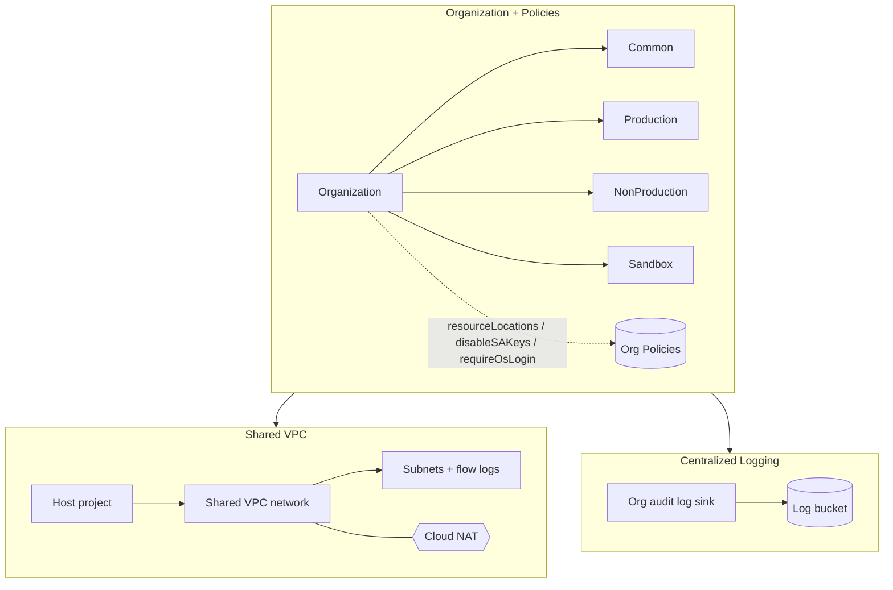

# Terraform GCP Landing Zone

[](LICENSE)
[](https://github.com/abhisheksawant52/terraform-gcp-landing-zone/actions/workflows/ci.yml)
[](https://www.terraform.io/)
[](https://registry.terraform.io/providers/hashicorp/google/latest)

A modular **Google Cloud landing zone** built with Terraform: a resource folder
hierarchy, organization policy guardrails, a Shared VPC host project, and
centralized audit logging — the foundation a GCP organization needs before
projects and workloads land.

## Overview

A well-run GCP organization separates concerns into folders, enforces guardrails
with organization policies, centralizes networking in a Shared VPC, and
aggregates audit logs into an immutable sink. This project encodes that
foundation as Terraform.

It targets platform teams bootstrapping a GCP organization or standardizing an
existing one. The root module composes three submodules — `folders`,
`networking`, and `security` — parameterized per environment (`dev`, `prod`).

## Architecture



Components:

- **folders** — organization folders plus organization policy constraints
  (allowed resource locations, disable service-account key creation, require
  OS Login).
- **networking** — Shared VPC host project, custom-mode VPC with flow-logged
  subnets, Cloud Router + Cloud NAT for private egress, and baseline firewall
  rules (internal + IAP SSH).
- **security** — a dedicated logging project, an immutable log storage bucket,
  an organization-wide aggregated audit log sink, and baseline org IAM.

## Features

- Folder hierarchy created from a simple list.
- Preventive org policies for location, key hygiene, and OS Login.
- Shared VPC with VPC Flow Logs and Cloud NAT egress.
- IAP-scoped SSH access instead of public SSH.
- Organization-level aggregated audit sink to versioned Cloud Storage.
- Environment isolation with per-environment tfvars and GCS state backends.

## Tech Stack

Terraform >= 1.5 · google ~> 5.30 · google-beta ~> 5.30 · Resource Manager
folders · Organization Policy · Shared VPC · Cloud NAT · Cloud Logging · GitHub
Actions · TFLint

## Getting Started

### Prerequisites

- Terraform >= 1.5
- `gcloud` authenticated with Organization Administrator + Billing permissions
- A pre-created GCS bucket for remote state (see `environments/*/backend.hcl`)
- The Shared VPC host project must already exist (referenced by `host_project_id`)

### Configure

```bash
cp terraform.tfvars.example terraform.tfvars
# set org_id, billing_account, host_project_id, subnets
```

### Initialize & plan

```bash
terraform init -backend-config=environments/dev/backend.hcl
make fmt-check
make validate
make plan ENV=dev
```

## Project Structure

```
.
├── main.tf                      # composes the three submodules
├── variables.tf
├── outputs.tf
├── versions.tf                  # required_providers + backend (commented)
├── providers.tf                 # google + google-beta providers
├── terraform.tfvars.example
├── modules/
│   ├── folders/                 # folders + org policies
│   ├── networking/              # Shared VPC, subnets, NAT, firewall
│   └── security/                # logging project, sink, IAM
├── environments/
│   ├── dev/{terraform.tfvars,backend.hcl}
│   └── prod/{terraform.tfvars,backend.hcl}
└── .github/workflows/ci.yml     # fmt / validate / tflint
```

## Configuration

| Variable             | Default              | Description                              |
| -------------------- | -------------------- | ---------------------------------------- |
| `org_id`             | _(required)_         | Numeric GCP organization ID.             |
| `billing_account`    | _(required)_         | Billing account for created projects.    |
| `region`             | `europe-west1`       | Primary GCP region.                      |
| `environment`        | `dev`                | Environment name.                        |
| `folders`            | `[Common, ...]`      | Top-level folders to create.             |
| `allowed_regions`    | `[europe-west1, ...]`| Regions allowed by org policy.           |
| `host_project_id`    | `acme-shared-vpc-host` | Shared VPC host project.               |
| `subnets`            | `{shared, workload}` | Subnets keyed by name.                   |
| `log_retention_days` | `365`                | Log bucket retention.                    |

## Deployment

Each environment has its own state backend and variables:

```bash
terraform init -backend-config=environments/prod/backend.hcl
terraform plan -var-file=environments/prod/terraform.tfvars
```

## Contributing

Contributions are welcome — see [CONTRIBUTING.md](CONTRIBUTING.md) and our
[Code of Conduct](CODE_OF_CONDUCT.md).

## Security

Please report vulnerabilities as described in [SECURITY.md](SECURITY.md).

## License

Released under the [MIT License](LICENSE).
